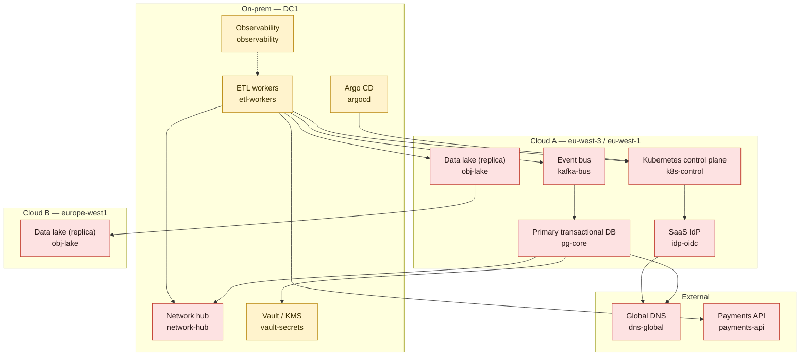

# C4 view — containers and failure boundaries

Level 2: the components of the model arranged by execution boundary. Colours follow the criticality of the [dependency graph](../generated/dependency-graph.md).

## Failure boundaries

| Boundary | What it protects | What it does not protect |
|---|---|---|
| Zones within a region | A server or AZ failure | Regional outage, DNS, IdP |
| Regions within a cloud | A regional outage | Cloud provider outage, shared identity |
| Two clouds | One cloud provider failing | Single DNS, on-prem hub, single SaaS IdP |
| Secondary on-prem site | Failure of the primary DC | Shared SaaS dependencies |

The model does not consider redundancy effective until the corresponding failover test is dated in `model/flows.yaml`.
