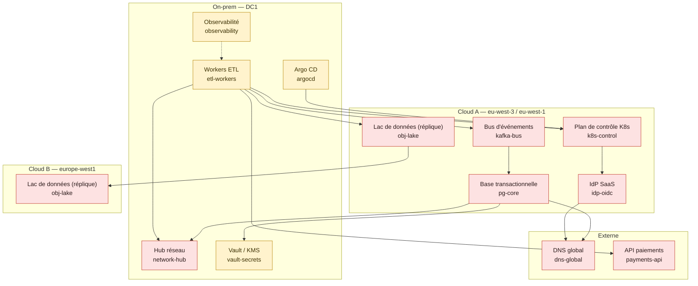

# Vue C4 — conteneurs et frontières de panne

Niveau 2 : les composants du modèle répartis selon leurs frontières d'exécution. Les couleurs reprennent la criticité du [graphe des dépendances](../generated/dependency-graph.md).

## Frontières de panne

| Frontière | Ce qu'elle protège | Ce qu'elle ne protège pas |
|---|---|---|
| Zones dans une région | Défaillance d'un serveur ou d'une AZ | Panne régionale, DNS, IdP |
| Régions dans un cloud | Panne régionale | Panne du fournisseur cloud, identité partagée |
| Deux clouds | Panne d'un fournisseur cloud | DNS unique, hub on-prem, IdP SaaS unique |
| Site on-prem secondaire | Panne du DC principal | Dépendances SaaS partagées |

Le modèle ne considère pas qu'une redondance est effective tant que le test de basculement correspondant n'est pas daté dans `model/flows.yaml`.
