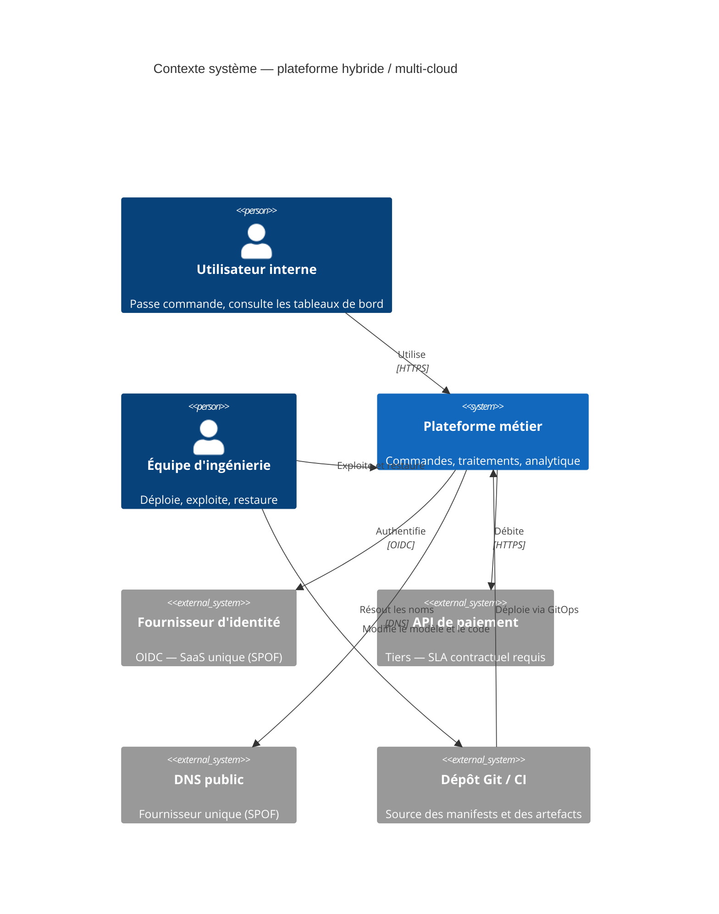

# Vue C4 — contexte système

Niveau 1 : la plateforme dans son environnement. Les systèmes externes sont des sources de risque hors de notre contrôle direct.

> Le rendu C4 de Mermaid nécessite une version récente (≥ 9). Le graphe détaillé des composants est dans [dependency-graph.md](../generated/dependency-graph.md).

## Lectures

- L'utilisateur ne voit que la plateforme : une panne de l'IdP, du DNS ou de l'API de paiement se traduit pour lui par une panne de la plateforme.
- L'équipe d'ingénierie est elle-même dépendante du dépôt Git/CI pour rétablir : à inclure dans l'analyse des SPOF si la CI est hébergée chez un tiers.
- Les flux et leurs objectifs sont détaillés dans `model/flows.yaml` et le [rapport de résilience](../generated/resilience-report.md).
