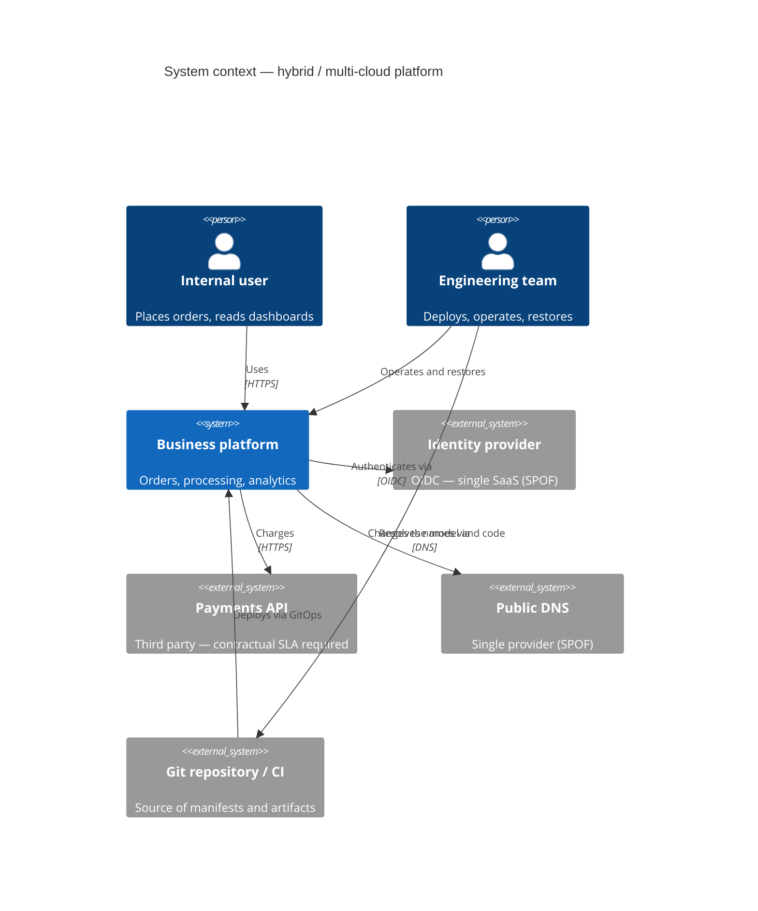

# C4 view — system context

Level 1: the platform in its environment. External systems are sources of risk outside our direct control.

> Mermaid C4 rendering requires a recent version (≥ 9). The detailed component graph is in [dependency-graph.md](../generated/dependency-graph.md).

## Reading this view

- The user only sees the platform: an IdP, DNS or payments API outage looks like a platform outage to them.
- The engineering team also depends on the Git/CI repository to recover: include it in the SPOF analysis if CI is hosted by a third party.
- Flows and their objectives are detailed in `model/flows.yaml` and the [resilience report](../generated/resilience-report.md).
