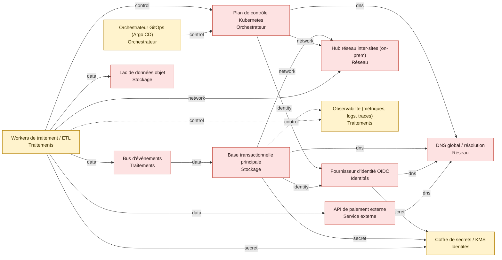

# Dependency graph

> Generated by `fortcloud-atlas graph`. Edit `dependencies.yaml` instead.

An arrow `A --> B` means **A depends on B**. The more arrows a node receives,
the larger its blast radius. Dotted links are non-critical dependencies (`required: false`).

## Legend

| Colour | Criticality | Meaning |
|---|---|---|
| Red | P0 | Critical — interruption unacceptable |
| Amber | P1 | Important — short degradation tolerated |
| Green | P2 | Support — recovery in hours |

## Most depended-upon nodes (blast radius)

| Component | Category | Criticality | Direct dependents |
|---|---|---|---|
| `dns-global` — DNS global / résolution | Réseau | P0 | 4 |
| `network-hub` — Hub réseau inter-sites (on-prem) | Réseau | P0 | 3 |
| `vault-secrets` — Coffre de secrets / KMS | Identités | P1 | 3 |
| `idp-oidc` — Fournisseur d'identité OIDC | Identités | P0 | 2 |
| `k8s-control` — Plan de contrôle Kubernetes | Orchestrateur | P0 | 2 |
| `observability` — Observabilité (métriques, logs, traces) | Traitements | P1 | 2 |
| `kafka-bus` — Bus d'événements | Traitements | P0 | 1 |
| `obj-lake` — Lac de données objet | Stockage | P0 | 1 |

See also: [resilience report](resilience-report.md).
