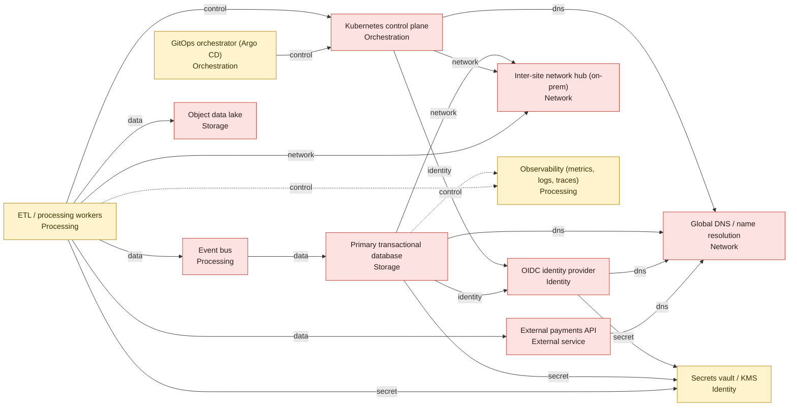

# Dependency graph

> Generated by `fortcloud-atlas graph`. Edit `dependencies.yaml` instead.

An arrow `A --> B` means **A depends on B**. The more arrows a node receives,
the larger its blast radius. Dotted links are non-critical dependencies (`required: false`).

## Legend

| Colour | Criticality | Meaning |
|---|---|---|
| Red | P0 | Critical — interruption unacceptable |
| Amber | P1 | Important — short degradation tolerated |
| Green | P2 | Support — recovery in hours |

## Most depended-upon nodes (blast radius)

| Component | Category | Criticality | Direct dependents |
|---|---|---|---|
| `dns-global` — Global DNS / name resolution | Network | P0 | 4 |
| `network-hub` — Inter-site network hub (on-prem) | Network | P0 | 3 |
| `vault-secrets` — Secrets vault / KMS | Identity | P1 | 3 |
| `idp-oidc` — OIDC identity provider | Identity | P0 | 2 |
| `k8s-control` — Kubernetes control plane | Orchestration | P0 | 2 |
| `observability` — Observability (metrics, logs, traces) | Processing | P1 | 2 |
| `kafka-bus` — Event bus | Processing | P0 | 1 |
| `obj-lake` — Object data lake | Storage | P0 | 1 |

See also: [resilience report](resilience-report.md).
